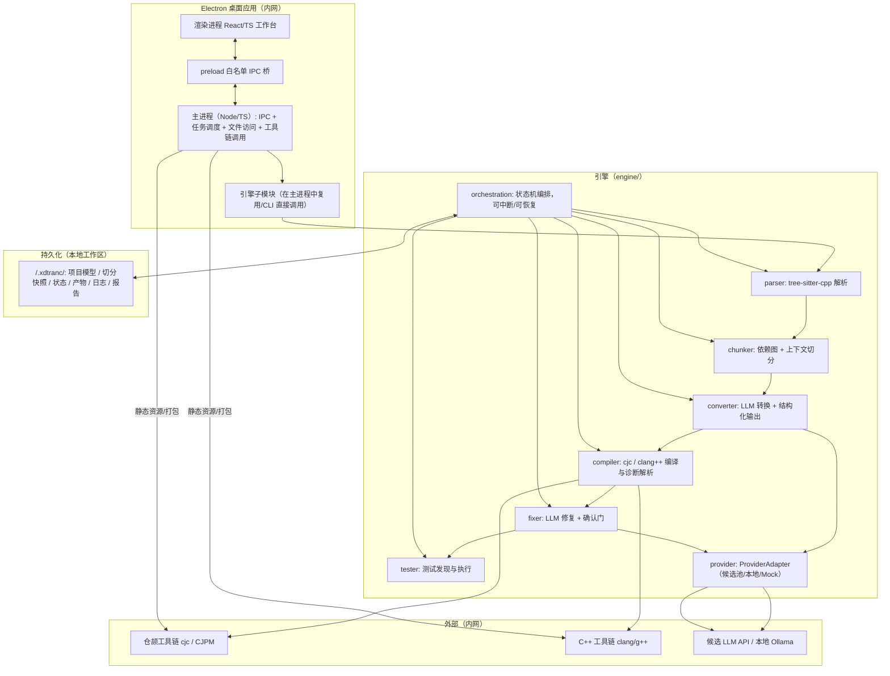

# Technical Design Document: XDtranC（乾坤大挪移）MVP

## Executive Summary

**System:** XDtranC（乾坤大挪移）——跨语言项目级源码转换工具
**Version:** MVP 1.0
**Architecture Pattern:** Electron 桌面应用 + 本地流水线引擎（模块化单体，Monolith-with-Modules）
**Estimated Effort:** 约 8–12 人·周（新手团队 + AI 辅助构建的**估算**，随 C++ 子集范围与编译验证工作量浮动，待课题排期确认）
**Migration Loop:** 项目导入 → 解析 → 代码切分 → LLM 转换（自核查）→ 仓颉编译验证 → LLM 自动修复（轮次上限 + 重大变更人工确认）→ 测试验证 → 转换报告

本设计承接 `PRD-XDtranC-MVP.md`（Stage: prd，用户等级 B——developer，新手团队）与 `research-xdtranc.md`（Partial research）的既定决策：

- **MVP 范围仅 C++ → 仓颉**；最终扩展至 C++ / Java / ArkTS 共 3 种源语言。
- **验收目标**：5 个 ≥2k 行代码库；转换后编译错误行占比 < 15%；人工修复后测试用例失败率 < 20%；敏感代码不用于模型训练（华为企业数据合规）。
- **产品内 LLM 用户自选**，默认 DeepSeek-V4-Flash（免费有限额）起步，可切换候选 / 本地兜底。

### 已确认的关键技术决策（Part 3 访谈结论）

| 决策点 | 结论 |
|---|---|
| 桌面形态与引擎语言 | **Electron + TypeScript 全栈**（React/TS 渲染进程 + Node/TS 主进程引擎），CLI 复用同一套引擎代码 |
| C++ 解析器 | **tree-sitter-cpp**（WebAssembly/Node 原生绑定），辅以少量正则兜底，覆盖「文件/类型/依赖识别 + 切分」粒度 |
| LLM Provider 接入范围 | 仅接**候选池（OpenAI 兼容接口抽象）+ 预留本地兜底（Ollama / OpenAI-compatible）**；外部付费 API 不纳入 MVP，避免未确认的 ZDR/不训练条款风险 |
| 编译执行环境 | 内网 **Linux/Windows 环境可安装 cjc/CJPM 与 clang/g++**，按真实编译验证 + C++ 基线对比设计；工具链路径可配置并有环境自检降级 |

---

## 1. Architecture Overview

### 1.1 High-Level Architecture



### 1.2 进程边界与数据流

- **渲染进程**：仅做视图与输入；不直接访问文件系统与 Node API（`nodeIntegration: false`、`contextIsolation: true`）。
- **preload**：以最小白名单暴露 IPC（`invoke/onProgress/onAwaitApproval` 等），所有文件读写、子进程执行、密钥读取都在主进程完成。
- **主进程**：持有引擎实例与任务调度器，向渲染进程推送流水线状态事件（切分/转换/编译/修复/测试阶段、进度、需确认的修复建议、报告）。
- **CLI**：`packages/cli` 直接复用 `packages/engine` 的同一批服务函数，不含 Electron 依赖，保证「桌面工作台形态 + 命令行能力」一致性。

### 1.3 Tech Stack Decision

| 层 | 选择 | 备选对比 | 选择理由 | 权衡 / 诚实说明 |
|---|---|---|---|---|
| 桌面壳 | **Electron** | Tauri（Rust 内核，更轻更省内存）；原生（Qt/WinUI，开发慢） | 生态成熟、Node 侧天然适合调用子进程与本地工具链；TypeScript 全栈单一语言，AI 辅助生成质量高，新手团队最易上手 | 包体大（~100MB+）、内存占用高；内网工具 + 单用户可接受；未来若在意资源可评估 Tauri |
| UI 框架 | **React 18 + TypeScript + Vite** | Vue 3；Svelte | 团队/AI 语料最丰富、组件生态成熟；Vite 冷启动快利于迭代 | 需要维护依赖心智；本项目仅一个工作台页面，React 足够 |
| 样式 | **Tailwind CSS**（自定义工程风主题） | CSS Modules；Ant Design/MUI 组件库 | 快速实现「专业、工程感、克制配色」；组件库风格过于「消费级」，与本项目设计语言不符 | Tailwind 类名可读性需规范；基础组件（树/表格/差异视图）需自建或引入轻量库 |
| 桌面 UI 基础组件 | 自建轻量组件 + `monaco-editor`（源码/产物/差异查看） | 重组件库 | 工作台对编辑器、差异视图、状态流有强定制需求；Monaco 满足「错误点击直达源码行」 | Monaco 体积大，需动态导入（lazy load）控制启动时间 |
| 引擎核心语言 | **TypeScript（Node.js）** | Python（脚本/解析生态强）；Go/Rust（性能强） | 与前端同语言、契约（schema）共享；异步编排、流水线事件天然契合；新手团队单一语言心智负担低 | Node 单线程，大项目解析/切分可能偏慢；MVP 规模（2k 行）内可接受，后续并行化用 worker_threads 或抽 Python 服务 |
| C++ 解析 | **tree-sitter-cpp**（`web-tree-sitter` 或原生绑定） | Clang LibTooling（AST 精确但集成重） | 轻量、TS 绑定成熟、增量/容错解析，够支撑「识别文件/声明/依赖 + 切分」；研究底稿亦列其为候选 | 语法级，不覆盖完整语义（重载/模板全语义需运行时确认）；复杂语义结构列入「不支持项显式报告」 |
| LLM 接入 | **OpenAI-compatible 抽象 + Ollama 本地兜底** | 直接接各家原生 SDK；接外部付费 API | 候选池（DeepSeek-V4-Flash 等）多为 OpenAI 兼容形态；一套客户端覆盖候选 + 本地；默认不落云满足合规 | 各家特殊能力（如结构化输出的严格模式差异）以 Reduce 处理；Mock Provider 保证离线可测 |
| 持久化 | **本地 JSON 文件 + 工作区目录组织**（无数据库） | SQLite（better-sqlite3，检索强） | 单一用户本地工具、数据量小（项目模型/状态/报告）；JSON 直观、易排障、无迁移负担 | 报告检索/历史聚合能力弱；达上百次转换后可评估 SQLite（P2） |
| 测试 | **Vitest + React Testing Library + Playwright（Electron E2E）** | Jest；Cypress | Vite 生态配套；Playwright 对 Electron 有官方支持 | E2E 需内网真实工具链，标记为集成/E2E 分层运行 |
| 打包分发 | **electron-builder**：Windows NSIS / Linux AppImage+deb | 手动脚本；Electron Forge | electron-builder 覆盖内网目标平台、配置简单 | 需内网镜像依赖；签名/更新按课题要求后置（P2） |

### 1.4 目录结构（Monorepo，pnpm workspaces）

```
xdtranc/
├── package.json                # workspace 根：脚本编排（dev/build/test/pkg）
├── pnpm-workspace.yaml
├── tsconfig.base.json          # strict 基础配置
├── .editorconfig / .prettierrc / eslint.config.mjs
├── docs/                       # PRD、本设计、后续 Part4 产物
├── e2e/                        # Playwright for Electron（主用户旅程）
├── samples/                    # 公开/自建 C++ 样例库（流程验证用，含基线构建脚本）
└── packages/
    ├── shared/                 # 类型契约、结构化输出 JSON Schema、错误码、常量
    │   └── src/
    │       ├── contracts.ts    # ProjectModel/Chunk/Diagnostic/FixProposal/Report
    │       ├── outputSchema.ts # 转换/修复的结构化输出 schema
    │       └── errors.ts       # 显式错误体系（见 §8）
    ├── engine/                 # 核心引擎（跨桌面/CLI 复用，无 Electron 依赖）
    │   └── src/
    │       ├── parser/         # tree-sitter-cpp：文件/声明/依赖
    │       ├── chunker/        # 依赖图 → 上下文切分
    │       ├── converter/      # LLM 转换 + 自核查重试
    │       ├── compiler/       # cjc / clang++ 调用、诊断解析、错误行占比
    │       ├── fixer/          # 诊断 → LLM 修复 → 确认门
    │       ├── tester/         # 测试发现/执行、失败率统计
    │       ├── provider/       # ProviderAdapter（openai-compat/ollama/mock）
    │       ├── orchestration/  # 流水线状态机（可中断/可恢复/HITL）
    │       ├── workspace/      # .xdtranc 工作区读写、报告生成
    │       └── index.ts        # 对外服务函数（CLI 与主进程共用）
    ├── main/                   # Electron 主进程
    │   └── src/
    │       ├── ipc/            # IPC 通道定义与 handler
    │       ├── tasks/          # 任务调度、进度事件、确认门
    │       ├── settings/       # 工具链路径、Provider 配置、密钥（本机存取）
    │       └── index.ts
    ├── renderer/               # React 工作台
    │   └── src/
    │       ├── pages/          # 导入/切分/转换/编译/测试/报告 视图
    │       ├── components/     # 状态条、错误列表、差异视图、确认弹窗
    │       ├── hooks/          # 流水线事件订阅
    │       └── app.tsx
    └── cli/                    # CLI 入口（bin: xdtranc）
```

---

## 2. Component Design

### 2.1 引擎模块职责与关键接口（TypeScript 伪代码，均为内部服务层契约，非 HTTP）

```ts
// packages/shared/src/contracts.ts
type TaskState =
  | "imported" | "parsed" | "chunked"
  | "converting" | "converted"
  | "compiling" | "compiled"
  | "fixing" | "awaiting_approval" | "fixed"
  | "testing" | "tested" | "reporting" | "done" | "failed" | "cancelled";

interface ProjectModel { root: string; files: SourceFile[]; deps: DepEdge[]; symbols: Symbol[]; }
interface Chunk { id: string; files: string[]; contextBundle: ContextBundle; estTokens: number; deps: string[]; }
interface ContextBundle { externalDecls: string[]; /* 跨 chunk 的声明/签名摘要 */ }
interface CompileDiagnostic { id: string; path: string | null; line: number | null; column: number | null;
  severity: "error" | "warning"; code: string | null; message: string; }   // path/line 为 null 表示「定位失败」分组
interface FixProposal { diagnosticsRef: string[]; patches: Patch[]; reasoning: string;
  impact: "minor" | "major"; confidence: number; }                          // major → 需人工确认
interface Patch { path: string; originalRange: {startLine:number; endLine:number}; newContent: string; }
interface PipelineEvent { taskId: string; state: TaskState; stage: string;
  progress: { done: number; total: number } | null; payload?: unknown; }
interface ConversionReport { inputStats: {files:number; lines:number}; chunkCount: number;
  convert: { rounds: number; tokenEstimate: number; failedChunks: string[] };
  compile: { totalErrors: number; errorLineRatio: number; /* 错误行/总产出行 */ unfilled: number };
  fix: { rounds: number; autoFixed: number; needHuman: number; history: FixProposal[] };
  test: { total: number; passed: number; failed: number; failRate: number; failedCases: string[] };
  provider: { id: string; model: string; estimatedCost: string | null; } }
```

```ts
// packages/engine/src/provider/provider.ts —— Provider 抽象（核心合规点：默认不落云）
interface LlmProvider {
  id: string; displayName: string; isLocal: boolean;
  listModels(): Promise<string[]>;
  generate(req: { messages: ChatMessage[]; model?: string; schema?: object;
                   temperature?: number }): Promise<{ content: string; usage?: {in:number;out:number} }>;
}
// 适配器：OpenAiCompatibleProvider(baseUrl, apiKey?)   // DeepSeek-V4-Flash 等候选
//        OllamaProvider()                              // 本地兜底（openai-compatible /chat）
//        MockProvider(fixtures)                        // 离线测试与演示
```

```ts
// packages/engine/src/orchestration/pipeline.ts —— 状态机（可中断/可恢复/HITL）
interface PipelineOptions {
  providerId: string; model: string;
  chunkBudgetTokens: number;          // 切分上下文预算
  maxFixRounds: number;               // 默认 3（可配置，超限降级人工）
  maxSelfCheckRetries: number;        // 默认 2
  approvalPolicy: "auto" | "confirm-major";  // 默认 confirm-major
  abort?: AbortSignal;                // 支持 停止/断点保存
}
async function runMigration(taskId, project, opts): AsyncGenerator<PipelineEvent>
// - 每阶段结束向持久化状态写入 checkpoint（.xdtranc/state/<taskId>/task.json）
// - 启动时扫描未完成任务 → 提示「恢复」或「丢弃」
```

### 2.2 数据模型与持久化决策

**不引入数据库**（决策见 §1.3）。工作区结构：

```
<project>/.xdtranc/                     # 与源码树分离，不污染原始项目
├── settings.json                       # 工具链路径、Provider/模型、预算、轮次上限（敏感字段加密或外置）
├── model/                              # 解析产物
│   ├── project.json                    # ProjectModel（文件、符号、依赖边）
│   ├── chunks.json                     # 切分快照 + contextBundle
│   └── unsupported.json                # 「不支持项显式报告」清单（源位置 + 原因）
├── state/<taskId>/
│   ├── task.json                       # 状态机 checkpoint（可恢复）
│   ├── conversions/<chunkId>.json      # 转换单元（含 selfCheck、重试记录）
│   ├── patches/                        # 修复补丁副本（commit 语义，可回滚）
│   └── events.log.jsonl                # 结构化流水线事件（脱敏）
├── out/                                # 仓颉产物（按 chunk 的 package/模块 组织 + 根 package）
├── reports/<taskId>/                   # 转换报告（report.json + report.csv + report.md）
│   ├── compile-errors.csv              # 编译错误定位明细（错误行占比的依据）
│   └── test-results.json
└── logs/                               # 运行日志（脱敏，见 §10）
```

所有写操作都在主进程的 `workspace/` 服务内完成，并做「在项目根 `.xdtranc` 边界内」的路径校验，防止任意路径写入。

### 2.3 流水线编排设计

- **编排器** 用轻量状态机实现（每阶段一个可中断的异步步骤），**不引入** LangGraph / Temporal 等重量级编排框架——MVP 阶段产品内 agent 只有「转换 + 修复」两个确定性流程，durable state 用 JSON checkpoint + 事件日志即可满足「重试、进度、HITL 确认门、断点恢复」；若后续引入多源语言分流、多策略并行，再评估工作流图引擎。
- **HITL 确认门**：`fixer` 产生 `impact: "major"`（或改动跨多文件、删改业务逻辑）的建议时，任务进入 `awaiting_approval`，渲染进程展示「修复建议 + 影响范围 + 理由 + 置信度」，用户确认/拒绝/编辑后继续。`impact: "minor"` 自动执行。
- **可中断与恢复**：每个 checkpoint 落盘；「停止」触发 AbortSignal，未完成任务列表在启动时提示恢复。

---

## 3. Feature Implementation

以下按 PRD 的 7 个 P0 功能给出实现要点：服务入口（CLI 命令与 IPC 通道）、业务逻辑、失败处理。**API 层指主进程内部服务与 CLI 的命令面**（本地工具无 HTTP）。

### F1 项目导入与解析（P0 / M）

**CLI：** `xdtranc import <dir|zip>` → `xdtranc parse <project>`
**IPC：** `project:import`、`project:parse`、`project:parsePreview`

- 导入支持目录/压缩包；复制为工作副本（或引用只读源 + 记录基线 hash），解析 `.h/.hpp/.cpp/.cc/.cxx`（`.c` 视配置）。
- tree-sitter-cpp 产出：文件单元、顶层声明/定义（class/struct/func/var/template/enum/macro）、`#include` 边、符号引用边。
- 行列容量统计：总行数、文件数 → 作为「≥2k 行」验收的输入口径。
- 解析失败的文件：登记到 `unsupported.json`（源路径 + 错误）并在 UI 明示，**不静默跳过**（PRD AC：解析失败明确报错）。
- 失败处理：无 C++ 文件 → 明确报错；编码非法文件 → 单文件跳过并登记，汇总提示。

### F2 代码切分（P0 / L）

**CLI：** `xdtranc chunk <project> --budget-tokens=...`
**IPC：** `chunk:run`、`chunk:preview`

- 依赖图预处理：`#include` 强连通分量压缩 → 拓扑排序。
- 切分算法：以 `chunkBudgetTokens`（默认按候选模型上下文 1/4 估算，可配置）为硬约束，结合内聚启发式（同模块/同目录优先、SCC 整体入 chunk）做贪婪聚合；每个 chunk 附带 `contextBundle`（被引用的跨 chunk 声明/签名摘要），保证「跨文件类型/调用依赖上下文完整」（PRD AC）。
- 成本/精度权衡：过小 chunk 上下文缺失，过大则超窗；`estTokens` 用估算函数（注释加权）预检，超限自动回拆。
- 进度可视化：渲染进程订阅 `chunk:progress`，可中断（AbortSignal）。
- 失败处理：无法归类的孤立文件单独成 chunk；依赖环无法解开的记录提示。

### F3 LLM 转换（C++ → 仓颉，P0 / M）

**CLI：** `xdtranc convert <project> --provider=... --model=...`
**IPC：** `convert:run`、`convert:retryChunk`

- Prompt 模板：系统提示（仓颉语言规约要点、映射表节选、结构化输出要求、**不支持项须显式报告**）+ chunk 源码 + `contextBundle`。
- 结构化输出契约（`outputSchema`）：

```jsonc
{
  "kind": "conversion",
  "outputs": [ { "path": "foo.cj", "code": "..." } ],          // 可多文件
  "unsupported": [ { "sourcePath": "foo.cpp", "line": 12, "reason": "..." } ],
  "selfCheck": { "passed": true, "issues": [] },
  "explanation": "对关键映射的说明",
  "confidence": 0.8
}
```

- **自核查**：`selfCheck.passed === false` 或 schema 解析失败 → 自动带问题回炉重试（`maxSelfCheckRetries`，默认 2）；仍失败登记 `failedChunks` 并在报告/UI 醒目提示，**不允许删除业务逻辑换取“通过”**（研究底稿约束）。
- Provider 切换：设置处选候选/本地/Mock；转换单元记录 `providerId/model`，支撑对比评测。
- 失败处理：上下文超限 → 自动收缩重试；API 限流/失败 → 指数退避（有限次）→ 切本地候选 → 明确报错并人工接管（PRD 降级行为）。

### F4 编译验证与自动修复（P0 / L）

**CLI：** `xdtranc compile <project>`、`xdtranc fix <project> --rounds=3`
**IPC：** `compile:run`、`fix:run`、`fix:approve`（确认门）、`compile:baseline`

- 环境自检：主进程启动时检测 `cjc` / `clang++`（配置路径或 PATH），产出「环境检测」状态面板；缺失时相关阶段禁用并明确提示（PRD：本地任务失败可重试）。
- 编译：对 `out/` 根 package 执行 `cjc build`（固定 SDK 版本，记录命令、退出码、诊断）；解析诊断 → `CompileDiagnostic[]`（含「定位失败」分组，如链接错误）。
- **错误行占比统计**：`unique error 行数（按 path+line 去重）/ 产出总行数 × 100` → 写入报告，作为 <15% 验收的直接口径；无行定位的归入「需人工」分组单独统计，**不删除代码强凑通过**。
- **C++ 基线构建**：`compile:baseline` 用 clang/g++ 构建原始样例库，产出基线退出码/输出快照，供测试阶段行为对比。
- 自动修复：fixer 取本轮诊断分组 → LLM 生成 `FixProposal`（补丁 + impact 分级 + 置信度）→ `impact=minor` 自动应用并复编译；`impact=major` 进入 `awaiting_approval` 确认门。
- 轮次上限：`maxFixRounds`（默认 3，可配）；超限 → 剩余诊断降级人工（PRD：修复动作在重大变更时需用户确认）。
- 失败处理：复编译仍失败的诊断保留为「未修复」，报告汇总修复成功率。

### F5 测试验证（P0 / M）

**CLI：** `xdtranc test <project>`
**IPC：** `test:run`、`test:report`

- 测试发现：优先 CJPM 内建测试（`cjc test`）；无标准框架时支持自定义测试命令/清单（设置中配置）。**不编造框架**，发现失败能力有限时显式报告「未发现可执行测试」。
- 执行与统计：失败率 = 失败用例 / 总用例 × 100（<20% 验收口径）；产出 `failedCases` 明细。
- 行为对比（C++ 基线）：对同一组输入，分别运行 C++ 基线产物与仓颉产物，比较退出码与 stdout（数值输出明确容差），结果并入报告。
- 失败处理：无法运行（缺少依赖）的用例明确计数报告（研究底稿：无法运行的用例应明确报告）。

### F6 用户反馈修复（P0 / M）

**CLI：** `xdtranc feedback <project> --path=... --line=... --message="..."`
**IPC：** `feedback:submit`、`feedback:history`

- 用户在产物/错误视图标注位置（文件 + 行 + 描述）→ 归并为「人工诊断条目」→ 交给 fixer 走「修复 → 编译 → 测试」复验闭环（PRD AC：回到编译/测试闭环）。
- 反馈历史：`state/<taskId>/patches/` + `fixHistory`，可回滚与追溯（差异视图可看每次修复前后）。
- 失败处理：用户标注定位无效 → 提示；修复后复验未通过 → 保留用户描述并降级人工。

### F7 输入/输出工作台（P0 / S）

**IPC：** `workbench:loadSource`、`workbench:saveOutput`、`workbench:export`、`workbench:diff`

- 输入区：粘贴源码（走「临时项目」管道，仍可切分/转换/编译/测试）；导入项目目录/压缩包。
- 输出区：产物浏览（Monaco）、side-by-side 差异对比（原 C++ vs 仓颉，基于源映射）、导出目录/压缩包。
- 流水线状态条：切分/转换/编译/修复/测试/报告 六段状态 + 进度 + 可中止；编译错误列表点击直达源码行（`monaco` 的 inline decoration）。
- 报告面板：指标卡片（错误行占比、测试失败率、轮次、估算成本）+ 导出（report.md / report.csv）。

---

## 4. AI / LLM Integration

- **用 户 场 景**：代码转换 Agent + 编译错误修复 Agent（流水线化，非对话式）；二者共用同一 `LlmProvider` 抽象与降级链。
- **数据边界（合规核心）**：默认使用候选模型（DeepWorks 可用候选池，默认 DeepSeek-V4-Flash，免费有限额）；企业数据默认不离开内网——候选模型无法满足时切本地 Ollama（Qwen2.5-Coder 等）。外部付费 API 不纳入 MVP。发送给模型的载荷 = chunk 源码 + contextBundle + 诊断片段 + prompt，**不发送**无关文件/日志/密钥。
- **保留/训练设置**：MVP 接入前逐项确认候选池各模型的「不用于训练 / ZDR」承诺与额度；不可确认的模型列入 Open Questions，不允许静默外发（对应 PRD 未决问题 1/6）。
- **结构化输出**：转换/修复均绑定 JSON Schema（`outputSchema`），解析失败走自核查重试链。
- **工具权限**：LLM 本身不直接触工具；其「动作」由引擎转化为受限文件写（仅 `.xdtranc/` 边界内补丁）与子进程调用，外部网络访问与重大修复走确认门。
- **延迟/成本目标**：单 chunk 转换目标分钟级以内；总流水线 2k 行项目目标分钟级闭环（估算）；成本上限（单项目 token 预算）在设置中可配，超限暂停并提示。
- **失败兜底**：API 失败/限流 → 指数退避（≥3 次）→ 切本地候选 → 明确报错人工接管；上下文超限 → 自动收缩 chunk；轮次超限 → 降级人工。
- **用户确认**：`impact=major` 的修复、外部网络访问、敏感数据外发前必须确认。
- **评测集（Eval Set，沉淀到 samples/evals）**：直接用例（可编译可测试）、间接用例（跨文件依赖）、负面用例（误改正确代码检测）、失败路径（Provider 超限/上下文超限/鉴权失败/解析失败）、全流程轨迹。
- **遥测**：事件日志、token 用量、耗时全额记录（脱敏、去标识化），不包含代码全文与密钥。

---

## 5. Security Implementation

- **身份与授权**：本地内网单用户工具，**不引入账号体系**（PRD 明确）；文件访问边界在项目根 `.xdtranc/` 内做路径校验。
- **Electron 加固**：`contextIsolation: true`、`nodeIntegration: false`、`sandbox: true`，渲染进程仅经 preload 白名单 IPC 访问主进程能力；不启用 `webSecurity` 放宽；外部链接用 `shell.openExternal` 且仅协议白名单。
- **密钥管理**：Provider API Key 存本机（Windows Credential Manager / Linux keyring，退化为受限权限配置文件），不写入日志、不提交仓库、不随报告导出。
- **日志脱敏**：日志不记录代码全文、不记录密钥；事件日志去标识化（见 §10）。
- **补丁与回滚**：每次修复生成补丁副本，支持整体回滚到任意 checkpoint。
- **数据合规**：默认不落云；候选模型「不训练」承诺清单（Open Questions 待确认）；企业代码不用于任何训练场景。

---

## 6. Performance Optimization

- **MVP 目标（估算，非承诺）**：2k 行项目「转换 + 3 轮修复」分钟级闭环；以实测为准，不虚构数字。
- **异步与进度**：任务全部异步，主进程持有状态机，渲染进程订阅事件；转换/修复按 chunk 并行（受候选 Provider 并发额度约束，P2 量级）。
- **缓存（P2）**：转换结果缓存 key = `hash(chunk 内容 + 源语言 + 目标 SDK 版本 + prompt 版本 + provider/model)`；同项目重复转换命中缓存跳过付费与等待（PRD P2「断点续转 / 缓存」）。
- **体验优化**：Monaco 懒加载；切分预计算一次缓存 `chunks.json`；解析增量更新（tree-sitter 增量解析潜力，MVP 先全量，P2 增量）。

---

## 7. Development Workflow

### 7.1 AI-Assisted Development Strategy（研发期）

| 阶段 | 主要工具 | 辅助 | 用途 |
|---|---|---|---|
| 架构评审 | DeepWorks（本会话） | Claude/ChatGPT（备选付费助手） | 方案复核、官方文档核对 |
| 实现 | DeepWorks / Cursor / VS Code+Copilot 视团队习惯 | — | 按本设计与 AGENTS.md 实现 |
| 调试 | DeepWorks | 官方文档 + 日志 | 流水线故障定位 |
| 测试 | DeepWorks 生成 + 团队补充 | Vitest/Playwright 自动核验 | 关键路径质量门 |
| 文档 | DeepWorks | — | PRD/设计/使用说明维护 |

> 开发助手与产品运行时 LLM 用同一候选池但**目的不同**，订阅费、API 费与第三方服务费分别核算（研究底稿明确）。

### 7.2 Git Workflow

- 单仓库 pnpm monorepo；分支模型 **Trunk-based**（内网小团队）+ 短生命周期特性分支（`feat/<name>`、`fix/<name>`）。
- Commit 约定：`type(scope): 描述`（type ∈ feat/fix/docs/chore/test/refactor）。题设新手团队不强制 Conventional 全量，**首字母类型前缀 + 中文描述**即可，保持可读。
- 评审：PR/MR 需 ≥1 人 + 引擎关键路径需过 CI 门。
- `.gitignore`：忽略 `.xdtranc/`（状态/产物/密钥/日志）、`node_modules`、`dist`、构建产物。**敏感样例库不入库**，验收库走课题内网通道。

### 7.3 Pre-Commit Hooks

- `husky + lint-staged`：提交前跑 `prettier`、`eslint` 修改文件；类型检查建议在 CI/预提交钩子中执行（引擎改动必须 `typecheck` + 相关单测通过）。

### 7.4 CI/CD Pipeline

- MVP 内网无云；若课题环境提供 GitLab CI：Linux agent 上 `pnpm install → typecheck → lint → unit test → build → (可选 e2e：需 cjc/样例)`，合并门 = typecheck + lint + unit。真实编译验证（cjc）因依赖工具链与验收库，移至课题验收环境手动/按流程执行，不伪造「CI 即通过」。

---

## 8. Testing Strategy

### 8.1 分层与命令

| 层 | 工具 | 命令 | 覆盖 |
|---|---|---|---|
| 引擎单元 | Vitest | `pnpm --filter engine test` | 解析（快照）、切分（golden chunk）、错误行占比统计、Provider 适配（Mock）、状态机 |
| 前端组件 | Vitest + RTL | `pnpm --filter renderer test` | 状态条、错误列表、确认门组件渲染 |
| 集成（需环境） | Vitest（integration 标记） | `pnpm --filter engine test:integration` | 真实 cjc / clang/g++ / Ollama（有则跑，无则 skip 并提示） |
| CLI 冒烟 | Vitest / shell | `pnpm --filter cli test` | import/parse/chunk/convert(mock)/compile/feedback 命令返回码与产物 |
| E2E | Playwright for Electron | `pnpm e2e` | 主旅程：导入→切分→转换→编译→修复确认→测试→报告；需内网工具链 |
| 评测集 | samples/evals 脚本 | `pnpm eval` | 编译通过率、测试通过率、修复成功率、负面用例、失败路径 |

### 8.2 质量门定义

- 单元 + 冒烟：PR 合并门（lint + typecheck + unit）。
- 集成 + E2E：课题验收环境手动/流程执行，输出记录版本、命令、退出码与诊断（可复现，研究底稿要求）。
- 类型检查：`tsc --noEmit`（strict）——新手团队 + AI 辅助下尤必要（PRD 质量标准）。
- 覆盖率目标：引擎核心（切分/编译器诊断解析/fixer 决策）单测覆盖目标 ≥ 80%（估算口径），UI 以关键交互 E2E 为主。

### 8.3 Visual Verification Loop（UI 变更）

1. **Generate**：AI 生成组件；2. **Render**：`pnpm dev` 预览；3. **Inspect**：截图 + 设计原则检查（专业/克制/信息密度）；4. **Refine**：回归前修正视觉问题。

### 8.4 Self-Healing Test Pattern

Playwright（或集成）测试失败时自动归档：失败命令、退出码、诊断输出、环境版本（SDK/cjc/clang）、截图（E2E）→ 复跑；仍失败则把诊断交给修复 Agent 生成补丁建议，人工确认后回归。

---

## 9. Deployment & Distribution（内网）

- **形态**：electron-builder 打包 `Windows NSIS（x64）` 与 `Linux AppImage/deb`；CLI 以 `npm link` / 独立二进制发布。
- **环境检测**：首次启动「环境自检」面板——检测 cjc/CJPM、clang/g++、候选模型连通性；缺失项明确列出并给出安装指引（对应决策 4）。
- **配置**：`settings.json`（工具链路径、Provider/模型、预算、轮次上限）可按课题环境预设为只读默认值，用户可覆盖为本地值。
- **分发**：内网制品仓库/共享盘；版本号与 SDK 版本一起记录于报告（可复现）。
- **无云依赖**：无需账号/托管/域名；不满足则按课题要求评估内网自托管更新通道（P2）。

---

## 10. Monitoring & Observability

- **本地日志**：结构化 JSONL（`logs/`），级别 trace/debug/info/warn/error；含**脱敏**规则：不记录源码全文、密钥、完整 Prompt（可记录 hash 与 token 计数）。
- **核心指标**：阶段耗时、token 用量、重试/轮次、错误行占比、测试失败率、修复成功率、Provider 调用成败（含限流/超时）。
- **遥测**：无外部遥测 SDK；如需课题统计，以「导出脱敏汇总 CSV」提供，不自动外发。
- **报告**：每次任务产出 `ConversionReport`（§2.1 契约），作为课题验收与成本控制的依据。

---

## 11. Cost Analysis

> **说明**：以下为**估算**，不是报价；一律以接入时的官方定价页/额度为准（PRD 研究底稿同样强调不编造数字）。

### 开发阶段
| 项 | 说明 | 预估 |
|---|---|---|
| AI 开发助手（DeepWorks） | 按当前账户/模型配置与额度确认 | 以实际额度为准，不虚构 |
| 桌面/工具开发环境 | Windows/Linux 内网、VS Code | 现有资源，边际 ≈ 0 |
| 验收库与工具链 | cjc / clang / g++ | 课题许可，无按量费用 |

### 运行阶段（产品内 LLM）
| 场景 | 估算口径 | 预估 |
|---|---|---|
| 默认候选（DeepSeek-V4-Flash） | 免费有限额起步，转换+3 轮纠错 ≈ 百万 token 级（PRD 研究量级估算） | 边际成本 ≈ 0（额度内） |
| 切其他候选模型 | 按实际用量与额度结算，设置成本上限 | 以官方定价页为准，标注估算 |
| 本地兜底（Qwen2.5-Coder 14B/32B） | 一次性硬件/算力（Q4 量化约 9–22GB 显存，研究数据，**非本课题实测**） | 无按量费用 |

### 不产生费用的项
托管、数据库、支付、第三方 SaaS——本地工具不涉及（PRD 明确非商业产品）。

---

## 12. Risk Mitigation

| 风险 | 概率 | 影响 | 缓解 |
|---|---|---|---|
| LLM 转换产物质量不足（错误行占比 ≥15%） | 高 | 高 | 迭代纠错闭环 + 切分上下文完整 + 候选模型对比评测；不成立时升级模型或补规则层（PRD 核心假设验证） |
| 候选模型额度/合规承诺未确认 | 中 | 高 | 默认本地兜底可用；外部付费 API 不入 MVP；承诺清单列为 Open Questions 逐项确认 |
| 仓颉工具链环境/版本障 | 中 | 高 | 固定 SDK 版本、环境自检、失败显式报告（不删除逻辑凑通过） |
| 解析器对复杂 C++ 子集覆盖不足 | 中 | 中 | 限定子集 + 不支持项显式报告 + tree-sitter 增量增强；必要时按研究建议评估 Clang 兜底（P2） |
| 新手团队维护复杂 monorepo | 中 | 中 | 单一语言、契约共享、严格 lint/typecheck、AI 辅助、文档沉淀 |
| 成本超限 | 低 | 中 | 单项目 token 预算上限设置 + 报告监控 + 缓存（P2） |
| 数据合规违规（外发训练） | 低 | 高 | 默认不落云、Provider 白名单、日志脱敏、开发期评审 |

---

## 13. Migration & Scaling Path

- **Phase 1 — MVP（C++ → 仓颉）**：本设计闭环；2k 行验收库 5 个；评测集沉淀。
- **Phase 2 — 扩展源语言（Java → 仓颉，对标 J2CJ 路线）**：新增 parser（tree-sitter-java）+ 语言映射表；架构已按「parser 可插拔」预留。
- **Phase 3 — ArkTS → 仓颉 与工程化**：多文件并行转换（worker_threads）、增量转换与缓存、SQLite 报告检索、内网分发更新通道。

---

## 14. Maintainability & Update Cadence

- 依赖稳定优先，避免无谓 churn；每月评审关键依赖（Electron、tree-sitter、monaco、React）与仓颉 SDK 版本。
- 更新本设计、`AGENTS.md`（Part 4 生成）与 CI/hook 命令随项目演进。
- 每次验收/形态变更在 Handoff Context 同步，避免后续会话丢失上下文。

---

## 15. Agent Architecture（产品内 AI 与研发 Agent）

### 15.1 产品内 Agent

- 两个确定性流水线 Agent：**转换 Agent**（parse-aware，输入 chunk + contextBundle，输出结构化仓颉 + 自核查）与**修复 Agent**（输入诊断 + 相关源码，输出补丁提案 + impact 分级）。
- **编排**：MVP 用轻量状态机（§2.3），满足一次为主、重试、进度、HITL、断点恢复；**不引入**工作流图引擎（避免过度工程，PRD Q10 立场）。
- **Agent 工具面**：LLM 不直接拿工具权限；全部动作经引擎受控执行（受限写、子进程、确认门）。

### 15.2 研发阶段 Agent（Planner-Executor-Reviewer）

- **Planner**：把功能拆为任务依赖图（对齐本设计与 PRD AC）。
- **Executor**：单任务实现 + 自测（typecheck/unit）。
- **Reviewer**：对照 AC 复核编码、边界与测试。
- 与 AI 工具集成点：官方文档核对（快变 API）、本地只读 schema/route/fixture 检查（改前先看）、权限分级（读/写/销毁）、验证命令以本设计为准。

---

## 16. Documentation Requirements

- [x] 技术设计（本文档）
- [ ] `docs/TechDesign-XDtranC-MVP.md` 评审通过后进入 Part 4（AGENTS.md、工程脚手架）
- [ ] Part 4 产物：`AGENTS.md`、PRD/设计引用、构建/检查命令、hooks/CI 配置
- [ ] 使用说明（课题演示用）、转换报告格式说明、内网部署/运行指南（PRD DoD）
- [ ] 架构决策记录（ADR）——本文档决策点落盘

---

## Open Questions（TBD，不在设计内捏造结论）

1. **MVP 技术栈已定**（Electron+TS / tree-sitter-cpp / 候选池+本地兜底）；**剩余运行时待确认**：候选池各模型的具体 model id、base URL、额度与「不训练/ZDR」承诺清单（对应 PRD 未决问题 1/6）。
2. 5 个 ≥2k 行验收库清单与来源（课题提供），MVP 阶段以 `samples/` 公开/自建样例库验证流程。
3. 仓颉 SDK 固定版本、平台（Win/Linux 内网）支持细节与 CJPM 测试框架确认（research 待核实清单第 1/4 项）。
4. CJPM 内建 `cjc test` 是否满足测试验证需求，或需自定义测试命令（§F5）。
5. 课题结项时间线与里程碑（影响 Phase 排期；当前工期为估算）。
6. 本地兜底模型（Qwen2.5-Coder 等）在关键样例上的转换质量基线（需接入后实测）。
7. 是否需要 SQLite 升级报告检索/历史（MVP 用 JSON，P2 评估）。
8. 内网分发通道（手工拷贝 vs 自托管更新）与代码签名要求。

---

*Version: 1.0*
*Last Updated: 2026-10-20*
*Next Review: 技术评审后 +1 个月*
*Technical Lead: TBD，由课题负责人确认*

---

## Handoff Context
<!-- Summary for the next workflow step. Keep this block with the saved document. -->
- Stage: techdesign
- App name: XDtranC
- User level: B（developer，新手团队）
- Target platform: 桌面工作台（Electron，Windows/Linux 内网）+ 命令行（CLI 复用引擎）
- Budget: 华为企业课题标准（未指定上限；运行成本以默认候选免费有限额起步，本地兜底无按量费用；均为估算，以官方定价页为准）
- Timeline: 以课题结项要求为准（具体日期待确认；MVP 工期估算 8–12 人·周）
- AI in product scope: yes（代码转换 Agent + 编译错误修复 Agent，流水线化，非对话式）
- Chosen stack: Electron + React18/TS/Vite + Tailwind + monaco；Node/TS 引擎（多模块单体）；tree-sitter-cpp 解析；OpenAI-compatible Provider 抽象 + Ollama 本地兜底 + Mock；本地 JSON 持久化（无数据库）；electron-builder 打包（NSIS/AppImage+deb）；Vitest + RTL + Playwright(Electron) 测试
- AI coding tool: DeepWorks（首选），备选付费编程助手视团队习惯；产品内 LLM 候选池默认 DeepSeek-V4-Flash（免费有限额）
- Constraints: MVP 仅 C++→仓颉；5 个≥2k 行验收库；编译错误行占比 <15%；人工修复后测试失败率 <20%；敏感代码不用于模型训练（默认不落云）；新手团队；桌面工作台形态；错误显式处理、不做半成品、关键路径必须测试
- Decisions: 桌面形态 Electron+TS 全栈；解析 tree-sitter-cpp；Provider 候选池+本地兜底（外部付费 API 不入 MVP）；内网环境可用按真实 cjc 编译 + clang/g++ 基线设计；构建目录结构 monorepo（shared/engine/main/renderer/cli）；无数据库（JSON 工作区）；轻量状态机编排（不引入工作流图引擎）；HITL 确认门（major 修复需确认）
- Open questions: 候选模型 model id/额度/不训练承诺清单；验收库清单；仓颉 SDK 固定版本与测试框架；课题结项时间线；本地兜底模型质量基线；SQLite 升级与否；内网分发与签名
- Research status: Partial research（2026-10-15 定向事实核查底稿；缺口见 research-xdtranc.md「待核实清单」）
- Source files: PRD-XDtranC-MVP.md、research-xdtranc.md → docs/TechDesign-XDtranC-MVP.md

```json
{
  "schemaVersion": 1,
  "documentType": "techdesign",
  "appName": "XDtranC",
  "stack": {
    "frontend": "React 18 + TypeScript + Vite + Tailwind CSS + monaco-editor（Electron 渲染进程）",
    "backend": "Node.js + TypeScript（Electron 主进程 / engine / CLI，多模块单体）",
    "database": "无数据库，本地 JSON 工作区（.xdtranc/）：模型/状态/产物/日志/报告",
    "auth": "不涉及（本地内网单用户工具，无账号体系）",
    "styling": "Tailwind CSS（自定义工程风主题，克制配色）",
    "deployment": "electron-builder：Windows NSIS / Linux AppImage+deb；CLI npm link；内网分发（无云托管）"
  },
  "commands": {
    "setup": "pnpm install",
    "dev": "pnpm dev",
    "test": "pnpm -r test",
    "typecheck": "pnpm -r typecheck",
    "lint": "pnpm -r lint",
    "build": "pnpm build && pnpm pkg"
  },
  "aiScope": "in-app AI（代码转换 Agent + 编译错误修复 Agent 流水线，非对话式；默认候选池不落云，本地 Ollama 兜底）"
}
```
